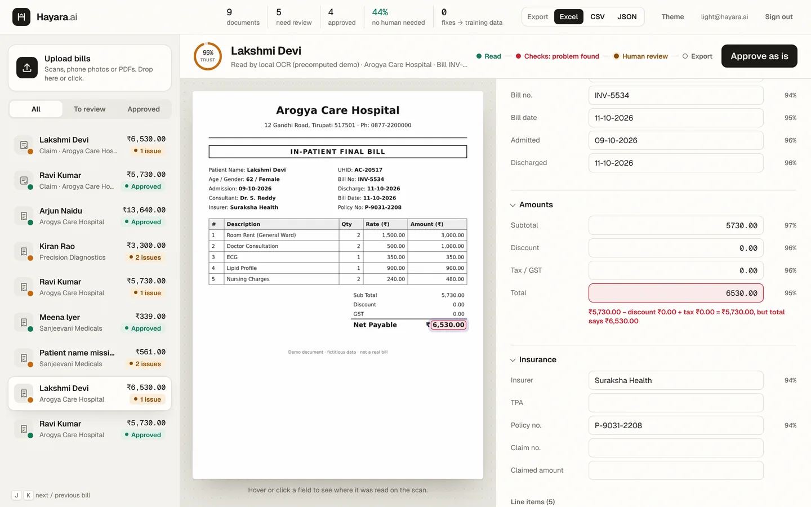
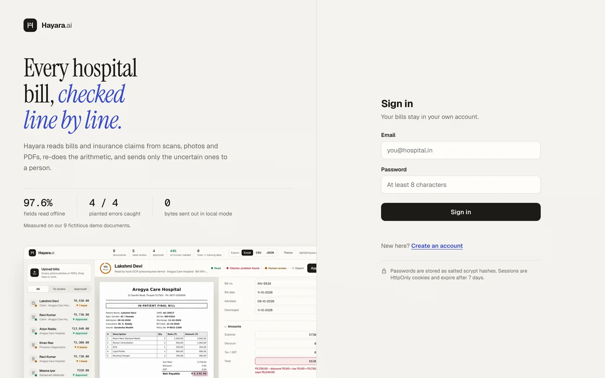
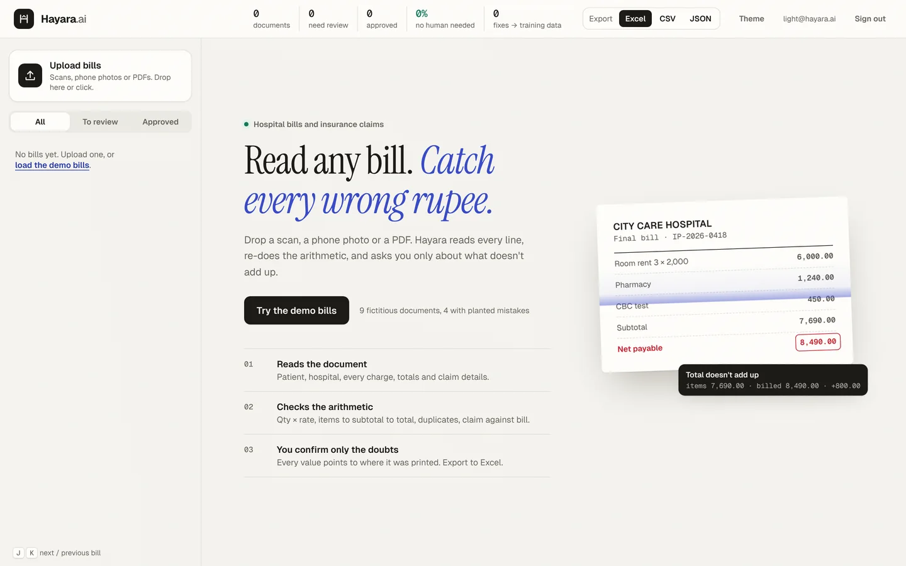
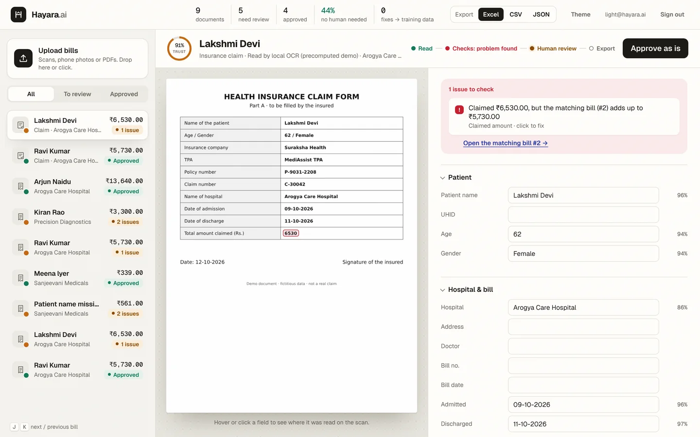
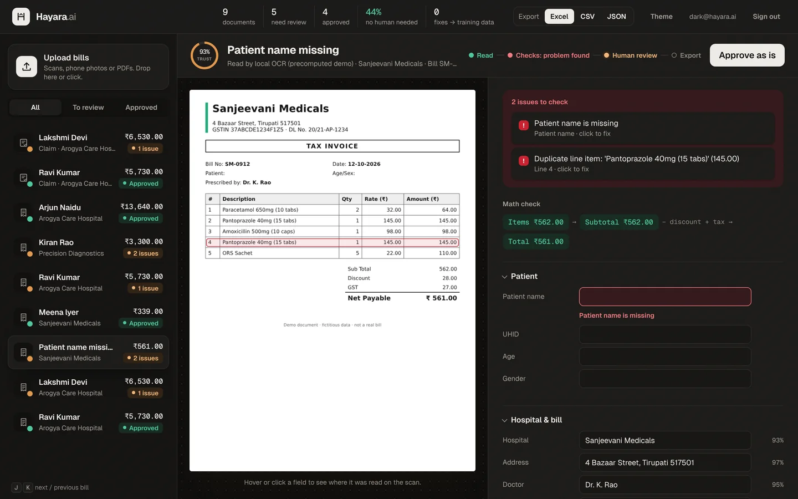
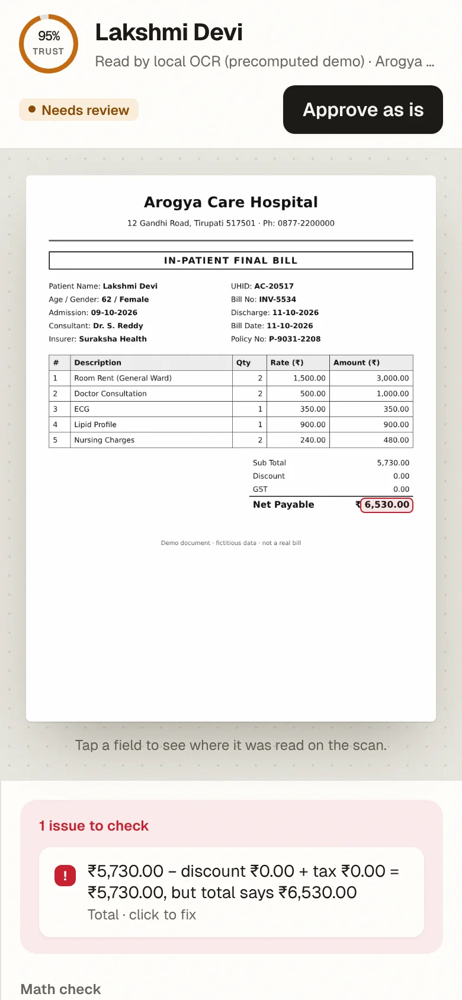
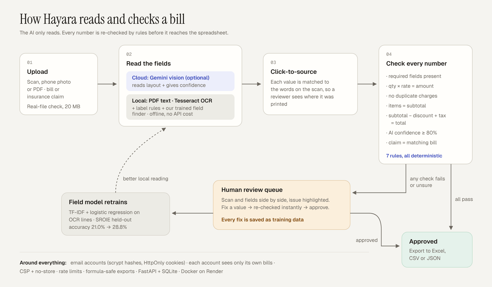

# Hayara.ai

**Every hospital bill, checked line by line.**
Hayara reads hospital bills and insurance claims from scans, phone photos and PDFs, re-does the arithmetic, and sends only the uncertain ones to a person.

**Live:** https://hayara-ai.onrender.com (free server: the first visit after a quiet spell takes about a minute to wake)
INNOHACKS 2.0 · AI Automation #3, *Hospital Bill and Insurance Reader* · Team The Alethians, SVCE Tirupati



## The problem
Hospitals send insurers thousands of bills a day, in every layout: scanned paper, phone photos, PDFs. People type them into spreadsheets by hand. Wrong totals, duplicated charges and over-claims slip through, and nobody checks the numbers until a claim is delayed or a patient pays too much.

## What Hayara does
- **Reads any bill or claim form:** patient, hospital, doctor, dates, every line item, subtotal, discount, tax, total, insurer, policy and claim details.
- **Re-checks every number** with 7 deterministic rules: the AI only reads, the rules decide.
- **Auto-approves clean documents;** only failed checks or low-confidence values reach a person.
- **Click-to-source:** every value is highlighted where it was printed on the scan, so a reviewer checks it in a second.
- **Claim against bill:** an insurance claim is matched to its bill (policy number, else patient name) and over-claims are flagged, with a link to the matching bill.
- **Fix, re-check and approve in place.** Every human correction is stored next to the AI's answer as training data.
- **Works offline:** Tesseract OCR, label rules and our own trained field finder. Gemini vision is optional.
- **Export** clean data to Excel, CSV or JSON. Amounts become real numbers, and formula injection is neutralised.
- **Accounts:** email sign-in, and each account sees only its own bills.
- Light and dark themes, phone layout, keyboard navigation (J / K), WCAG 2.2 AA checked with axe (0 violations).

## Screenshots
| | |
|---|---|
|  |  |
| **Sign in:** each account's bills stay private | **Start:** one click loads 9 demo documents |
|  |  |
| **Claim vs bill:** over-claim caught, link to the bill | **Dark theme:** missing name + duplicate charge |



## How it works


The 7 rules (`backend/validate.py`): `required` fields present · `line_math` qty × rate = amount · no `duplicate` charges · `items_sum` items = subtotal · `total_math` subtotal − discount + tax = total · `low_confidence` below 80% · `claim_match` claimed amount = what the matching bill adds up to (₹1 tolerance).

## Results (measured, not estimated)
| Engine | What was measured | Result |
|---|---|---|
| Gemini 3.8 Flash (cloud) | 6 demo bills, fresh calls ([EVAL_RESULTS.md](EVAL_RESULTS.md)) | **82/85 fields (96.5%)**, 28/28 line items, 6/6 correct verdicts |
| Local mode (OCR + rules, offline) | all 9 demo documents | **121/124 fields (97.6%)**; the blurry photo's table goes to review |
| Our trained field finder | 600 SROIE receipts, 20% held out | held-out field accuracy **21.0% → 28.8%** over rules alone |
| Validation | 4 documents with planted mistakes | **4/4 caught** |
| Validation | 4 clean documents | **4/4 auto-approved** |

The Gemini and local numbers come from our 9 fictitious demo documents. The field-finder numbers come from SROIE shop receipts, not hospital bills.

## Run it locally
```bash
pip install -r requirements.txt          # Python 3.12; also install Tesseract OCR and put it on the PATH
uvicorn backend.app:app --reload
```
Open **http://127.0.0.1:8000/**, create an account (any email, 8+ character password), and click **Try the demo bills**.

- **Fully offline:** `export EXTRACTOR=local` (PowerShell: `$env:EXTRACTOR="local"`) before starting. No API key is needed.
- **With Gemini:** set `GEMINI_API_KEY` (and optionally `GEMINI_MODEL`, a comma-separated fallback list). If Gemini fails (quota, network, no key), Hayara falls back to local OCR by itself, and the page says which engine read the bill.
- Without Tesseract, uploads still work with Gemini, but the click-to-source highlights are skipped.

```bash
python -m pytest                     # 34 tests: rules, API, accounts, isolation, security, exports; no API key needed
python eval.py --delay 5             # accuracy on data/samples vs data/truth (1 Gemini call per document)
python scripts/train_fields.py       # retrain the local field finder (imported datasets + every approved bill)
python scripts/precompute_demo.py    # refresh the saved engine output for the 9 demo documents
python scripts/make_demo_bills.py    # regenerate the fictitious demo documents and their correct values
```

### Demo documents (`data/samples/`, all fictitious)
| File | What's in it | Expected |
|---|---|---|
| `bill_01` | clean hospital bill | approved |
| `bill_02` | total says ₹6,530, items add up to ₹5,730 | review |
| `bill_03` | patient name missing + medicine billed twice | review |
| `bill_04` | clean pharmacy bill | approved |
| `bill_05_photo` | tilted, blurred phone photo of bill_01 | review |
| `bill_06` | lab invoice: HbA1c 2 × 400 billed as 900 | review |
| `bill_07.pdf` | clean bill as a PDF (read from its text layer) | approved |
| `claim_01` | claim for bill_01, amount matches | approved |
| `claim_02` | claim for bill_02, asks ₹6,530 vs ₹5,730 billed | review |

On the free server, reading a new document live takes 30-60 seconds, so the engine's output for these 9 is saved in `data/demo_cache/`. The page labels them "precomputed demo". Any other upload is read live.

## Project layout
```
backend/app.py          FastAPI: accounts, upload, review, export, security headers
backend/extract.py      Gemini vision extraction (structured output + confidence, model fallback)
backend/ocr_extract.py  local extraction: PDF text layer / Tesseract OCR + label rules
backend/field_model.py  trained field finder (TF-IDF + logistic regression) used by local mode
backend/locate.py       click-to-source: matches each value to word boxes on the scan
backend/validate.py     the 7 rules and the claim-vs-bill cross-check
frontend/               dashboard, sign-in page, 404 page, self-hosted fonts, images (no build step)
scripts/                demo data, dataset import, training, precompute
tests/test_hayara.py    pytest suite
docs/                   architecture diagram, screenshots, hackathon plan and slide content
```
**Stack:** Python 3.12, FastAPI, SQLite, Tesseract, pypdfium2, scikit-learn, google-genai, openpyxl. The frontend is plain HTML/CSS/JS. Deployed with Docker on Render.

## API
Every POST/PATCH needs the header `X-Hayara: 1`. Everything except sign-in, `/health`, fonts and images needs a signed-in session cookie.

| Endpoint | What it does |
|---|---|
| `POST /auth/signup`, `POST /auth/login` `{"email", "password"}` | Create an account / sign in (sets an HttpOnly session cookie) |
| `POST /auth/logout`, `GET /auth/me` | Sign out / who is signed in |
| `POST /upload` (form field `file`) | Read + check a JPG/PNG/WEBP/PDF. Returns `{id, status, data, issues}` |
| `GET /bills?status=review` | Your bills (`review`, `approved`, or all), with issue and fix counts |
| `GET /bills/{id}`, `GET /bills/{id}/file`, `GET /bills/{id}/preview` | One bill, its original scan, page 1 of a PDF as an image |
| `PATCH /bills/{id}` `{"field": "total", "value": "3450"}` | Human fix (also `line_items.2.amount`). Re-checked and saved as a correction |
| `POST /bills/{id}/approve` | Reviewer accepts the bill as is |
| `GET /export?format=xlsx\|csv\|json` | Your bills, spreadsheet-ready |
| `GET /samples`, `GET /samples/{name}` | The 9 demo documents |
| `GET /health` | `{"ok": true}` for uptime monitors |

Every issue is `{"field", "rule", "message"}`. `field` is a key in `data.fields` or `line_items.N`, so the page can highlight it.

## Security
- **Accounts:** passwords stored as salted scrypt hashes, session tokens stored only as SHA-256 hashes, HttpOnly + SameSite=Strict cookies (Secure on HTTPS), 7-day expiry. Sign-out deletes the session. 10 sign-in attempts per IP per 10 minutes, and the same answer for an unknown email and a wrong password.
- **Isolation:** every bill, scan, edit, approval and export is scoped to the signed-in account. Other accounts get 404.
- **Uploads:** only JPG/PNG/WEBP/PDF whose bytes really are that type, max 20 MB, with image-bomb and giant-PDF limits. Files are stored under a hash name, never the user's filename.
- **Abuse limits:** 40 uploads per IP per 10 minutes, one document read at a time, 500 documents per account.
- **Browser:** Content-Security-Policy (only our own scripts run, allowed by hash; fonts and images self-hosted), every value from a scan is HTML-escaped, `nosniff`, same-origin framing only, no referrer, HSTS, `Cache-Control: no-store`. No CORS. The custom header blocks cross-site writes.
- **Exports:** text that looks like an Excel formula is neutralised (`'=...`).
- **Secrets:** only in environment variables (`.env` is git-ignored). Local mode needs none.

## Deploy (free, Render)
The repo has a `Dockerfile` (Python + Tesseract) and a Render blueprint (`render.yaml`) that runs in local mode, so no API key is needed.
1. render.com → sign in with GitHub → **New → Blueprint** → pick this repo and branch.
2. Wait for the build (about 5 minutes). Optionally add `GEMINI_API_KEY` and remove `EXTRACTOR` to use Gemini first.
3. Keep it awake with a free uptime monitor on `/health` every 5 minutes.

## Known limits
- The free server's disk is wiped on restart, so accounts and bills go with it. Production would use PostgreSQL and object storage.
- No email verification or password reset yet.
- Click-to-source highlights cover page 1 of multi-page PDFs.
- Local OCR struggles with very blurry photos. Those go to review rather than through.

More: [DEMO.md](DEMO.md) (3-minute demo script and judge Q&A) · [EVAL_RESULTS.md](EVAL_RESULTS.md) · [docs/hackathon/](docs/hackathon/) (plan and slide content).
Fonts: Geist, Geist Mono and Instrument Serif, under the SIL Open Font License ([frontend/fonts/LICENSE.txt](frontend/fonts/LICENSE.txt)).
